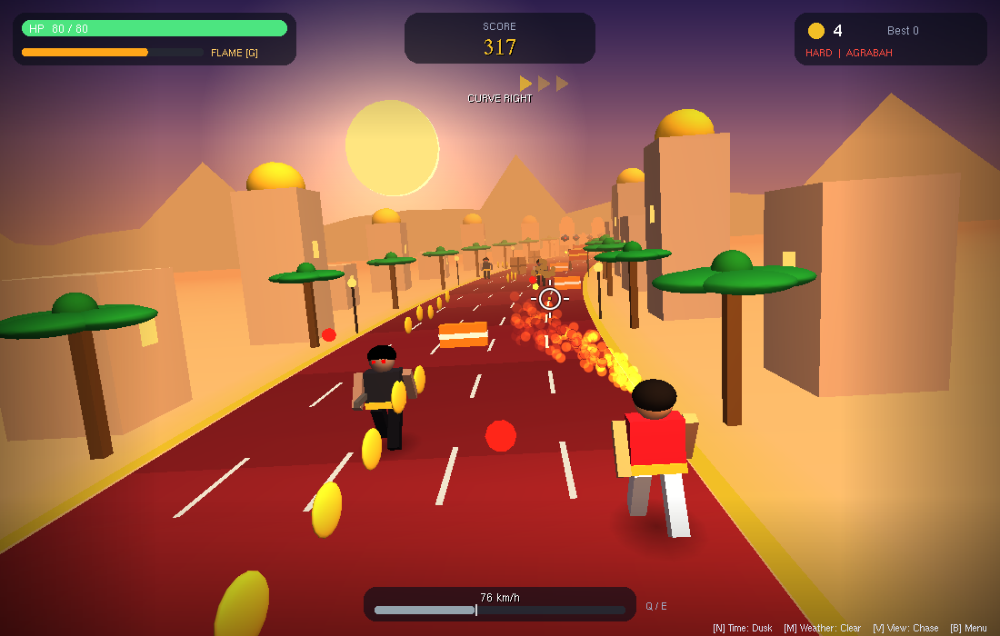
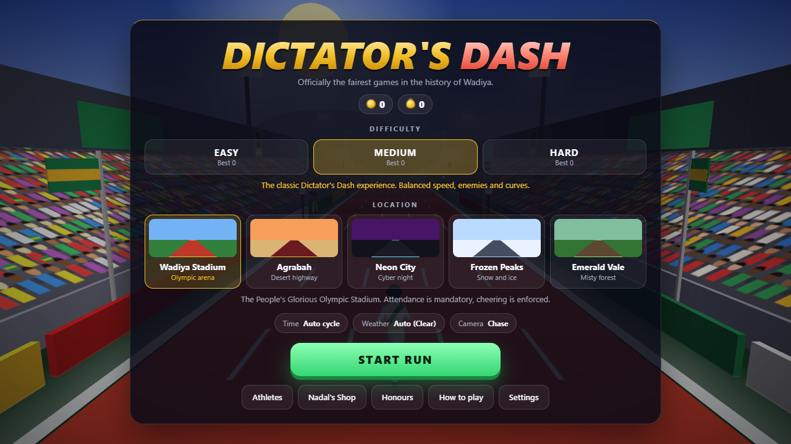
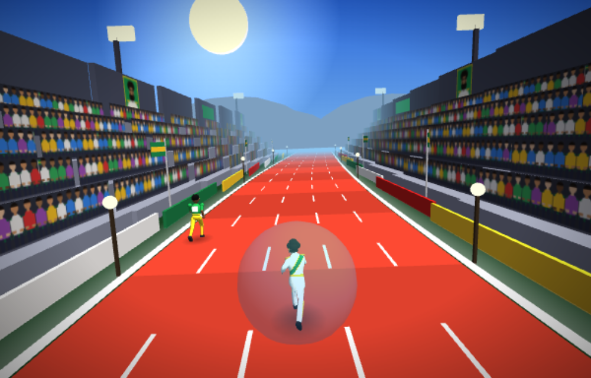
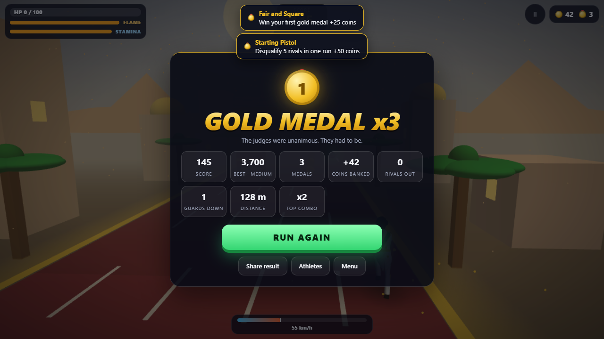
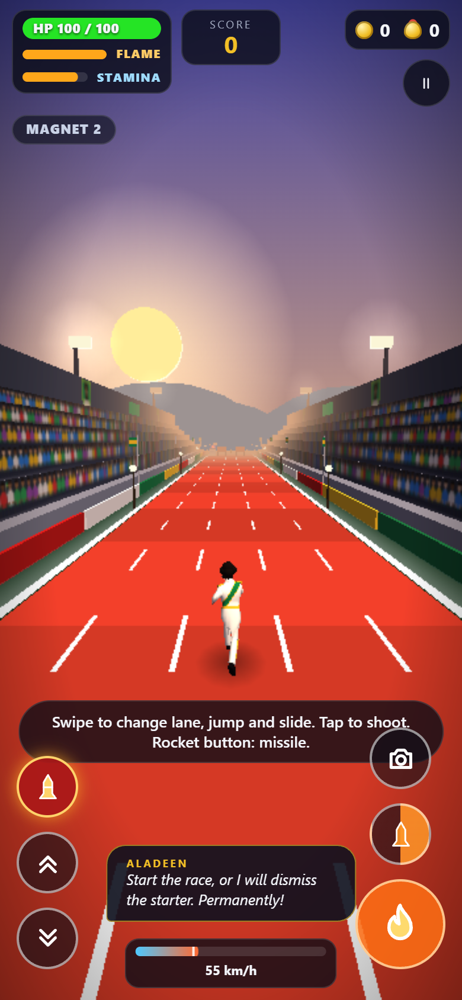
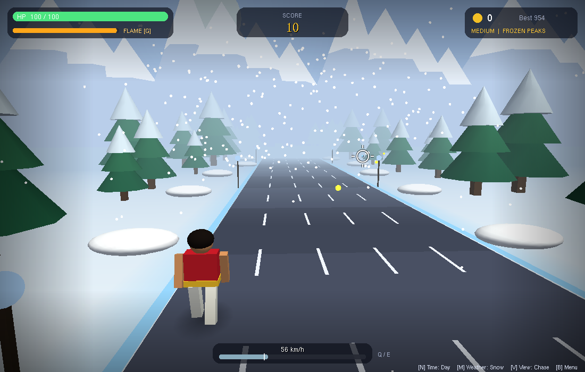
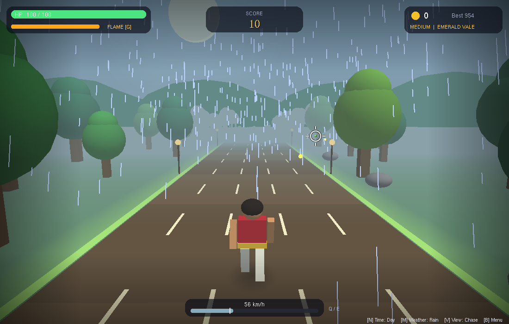
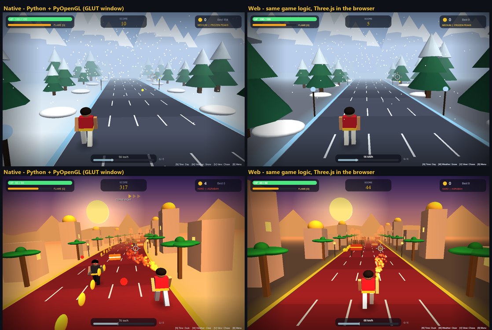
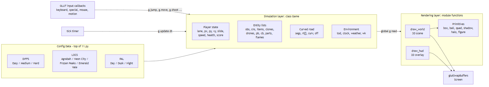

# Dictator's Dash 3D

An endless 3D lane-runner built with **Python + PyOpenGL (GLUT)** for the CSE423 Computer Graphics course. It also has a **web edition** in the browser that shares the same core simulation and adds new features (see [What's new in the web edition](#whats-new-in-the-web-edition-v4)).

Admiral General Aladeen sprints down a bending track: jump barriers, slide under beams, shoot crates, robot guards and drones, burn them with a flamethrower, and grab coins and power-ups. Pick from three difficulties and five locations (the web edition adds the Wadiya Olympic stadium), each with its own scenery, lighting, fog and weather. The native OpenGL build keeps its original four worlds and box-figure hero.

The theme is taken from the film *The Dictator*, where the ruler holds his own Olympics and wins every event. In the web edition that is the game: rival athletes can be "disqualified" (shot), guards carry the finish tape out to you every 400 m, and every run ends with a gold medal.



**▶ Play in the browser (web edition):** https://sm-mohibul-abrar.github.io/DictatorDash3D/

**⬇ itch.io (play online or download the Windows `.exe`):** https://mohib-abrar.itch.io/dictatordash3d

| Main menu | Neon City gameplay |
|---|---|
|  |  |
| **Run-over screen** | **Portrait phone** |
|  |  |

| Frozen Peaks | Emerald Vale |
|---|---|
|  |  |

## Features

- **Bending road**: random curvature segments are integrated into a lateral-offset table every frame. Game logic stays in straight lanes, and only rendering (and aiming) bends the world, so collisions stay simple. The camera banks into the turns.
- **4 worlds**: Agrabah (desert), Neon City (cyber night), Frozen Peaks (snow) and Emerald Vale (forest). Each has its own palette, fog distance, curve strength and weather odds.
- **3 difficulties**, each a data-driven table of about 20 tuned parameters.
- **Dynamic atmosphere**: day → dusk → night cycle with smoothstep blending, plus rain, snow and sandstorm weather that cross-fade, and lightning.
- **Combat**:
  - Pistol aimed with the mouse, using ray unprojection plus aim assist.
  - Hold-to-fire flamethrower with fuel and overheat, using a cone hit test.
  - Clone guards that chase your lane and shoot.
  - Drones that hover, fire aimed 3-D shots, then dive at you.
- **Presentation**:
  - Gradient sky, sun halo and far backdrop silhouettes.
  - Neon road edges, soft contact shadows and particles.
  - Rounded HUD panels, vignette, speed lines, a custom reticle and stroke-font titles.
- **Three camera views**: chase, first-person and overhead. The field of view widens with speed.

## What's new in the web edition (v4)

- **Rigged Olympics rules (web only)**: rival athletes jog ahead of you, hop barriers and duck beams. When you fire they freeze with their hands up; shoot them for points or go around. A finish tape arrives every 400 m: break it for a gold medal, +100 score x combo and +5 HP. Aladeen comments on all of it in short text lines (start, overtakes, disqualifications, power-ups, medals, defeat).
- **Democracy is the enemy**: robots carrying placards (VOTE, DEMOCRACY, FREEDOM, EQUAL RIGHTS) march up the track toward you and shoot, drones fire ballot papers, and the crates are ballot boxes. Destroying one pops ELECTION CANCELLED, POSTPONED or RIGGED. The finish tape is carried by Aladeen's own officials in dark suits.
- **Pistol**: a gold pistol in his hand, the arm straightens to aim when he fires, with a muzzle flash, tracer streaks and a gunshot with echo.
- **Stamina**: running above cruising pace drains a stamina bar; at empty he is exhausted for about 3 seconds (minimum speed, hunched, panting). Easing off or a health pick-up restores it.
- **Crowd**: the stands are a painted picture (nothing in them moves). The crowd screams when he fires and chants the runner's name on medals; both are synthesised, and `AUDIO_FILES` in `web/js/core.js` lets recorded clips replace them. Music keeps playing through pause.
- **Phone weight**: character models are fetched only when first needed (a fresh run downloads one model, about 1.8 MB, instead of three), and Medium quality gives the detailed model to at most two rivals.
- **Wadiya Stadium**: a fifth location with tiered stands with rows of seated spectators (painted and motionless), portraits of the Supreme Leader, banners, flags, trackside boards and floodlights, all drawn through the instanced shim.- **Athletes**: Admiral General Aladeen (default), Efawadh the body double (clumsy lane changes, coins count double), Zoey (quicker feet, higher jump) and an Elite Guard (30% more health), unlocked with banked coins. The roster shows a portrait of each one, rendered from the actual 3D model.
- **Nuclear Nadal's Lab**: six permanent upgrades, three levels each, paid for with banked coins. The **Pointy Hand Missile** (bought in the lab; X, or the rocket button) locks onto one enemy, marked by a red bracket, and destroys only that one; it reloads in 8, 6 or 4 s. On a laptop the missile and Beard of Doom show as round gauges that fill while they reload. The **Pointy Beard of Doom** (C) is bought in the lab, charges on kills and medals, then dives in from behind the stadium and clears the track. The **Coin Magnet** visibly pulls coins to him. Also longer rocket boots, longer rapid fire and more health.
- **Supporters** line the road in every location, behind a barrier with flags and ALADEEN signs (painted and still), and the crowd screams at gunfire everywhere. At the finish, two officials stand at the line holding the tape out.
- **Score** comes only from actions (coins, medals, enemies, disqualified rivals); running alone scores nothing.
- **Sound and voices** were generated with ElevenLabs: the crowd chants, scream, roar and background crowd, the effects (`web/audio/sfx-*.mp3`: pistol, missiles, Beard of Doom, ballot box, coins and so on), and every spoken line (`web/audio/voice/`): Aladeen's commentary, Nuclear Nadal in his lab, and a stadium announcer who calls the events, the gold medals and the pop-ups (DISQUALIFIED, ELECTION RIGGED...). The speech box stays on screen as a subtitle, and Settings has a Voices volume. Every file is optional: delete or replace one and the game falls back to its synthesised sound. The music is a synthesised Middle-Eastern march: bass drum and snare, oom-pah bass, a darbuka and a brassy lead.
- **Power-ups**: VIP pass (blocks one hit), rapid fire, health, and rocket boots (4.5 s of 1.5x speed during which nothing can hurt you).
- **Interface rebuilt in HTML/CSS**: readable on portrait phones, landscape phones and desktop; safe-area aware; medal banners, achievement toasts, floating score labels.
- **Progression saved in the browser**: coin bank, the athlete roster, 12 achievements with coin rewards, lifetime stats, and a share card: your result drawn as a 1080 x 1080 image (with your name on it) that goes to the system share sheet or downloads as a PNG.
- **Characters and movement**: the humans are rigged, skinned models (`web/js/actors.js`). Motion is stored model-independently in `web/models/moves.json` (per-joint world rotations away from the T-pose, baked from an unarmed run / idle capture) and retargeted onto each model when it loads, so models with different rest poses and facings all run straight. Runners turn to follow the track on bends and turn into lane changes; each run starts with an acceleration off the blocks. The slide, jump tuck, hands-up and cheer have no capture: they are joint rotations layered over the clip in code. If a model cannot load, the game falls back to a built-in figure drawn from primitives.
- **Kits**: one stock model becomes several people. A kit swaps outfit textures for plain colours and pins props to the joints: Aladeen's curls, beard, sunglasses, epaulettes and medals; the rivals' hair and race numbers (drawn onto a small canvas texture). Props on the same joint and material are merged into one mesh. Aladeen's green sash and gold belt are not props: a small shader patch colours the jacket by each point's rest-pose position, so they wrap round the body and bend with it. Guards that shoot and the tape carriers remain robots.
- **Model credits**: `web/models/man.glb` is the Ready Player Me sample avatar and `web/models/athlete.glb` ("Michelle") and `web/models/soldier.glb` ("Soldier") are the Mixamo sample characters, all taken from the Three.js examples repository. The motion in `moves.json` was baked from the Three.js "Xbot" sample. These are third-party assets under their own terms (Ready Player Me and Adobe Mixamo), not under this repository's licence; check those terms before any commercial use. Any character on the same skeleton exported as `.glb` can replace them.
- **Performance for weak hardware**: the OpenGL shim now batches all opaque solids with GPU instancing. The same Neon City scene went from 486 draw calls to 24 (measured in headless Edge). Quality setting Auto / Low / Medium / High; Auto lowers the render resolution, then the detail tier, when frames get slow. Physics runs in fixed 20 ms steps, so a slow device drops frames instead of running in slow motion.
- **Controls**: swipe gestures that act mid-swipe, tap to shoot with auto-aim (touch and gamepad), gamepad support (standard mapping), keyboard and mouse as before. Esc or P pauses; the game also pauses when the tab loses focus.
- **Audio**: synthesised sound effects and a procedural music loop through Web Audio (no audio files), with separate music / effects volume. Vibration on phones.
- **Installable and offline**: web app manifest + service worker; Three.js r128 is vendored in `web/vendor/`, so there is no CDN dependency. Fullscreen button, screen wake lock while running.
- **Accessibility options**: turn off screen shake and soften flashes, auto-aim toggle, FPS counter.

## Run the OpenGL version

```bash
cd native
python 11.py            # add --msaa for multisample anti-aliasing (GPU permitting)
```

- **Windows:** needs only Python 3. PyOpenGL and the freeglut DLLs are vendored in `native/OpenGL/`, so there is nothing to install.
- **Linux:** install system GLUT first (`sudo apt install freeglut3-dev`), then run `python3 11.py`.
- A harmless `numpy` warning may be printed. Sound effects are Windows-only.

## One game, two renderers



The simulation and 3D drawing in `web/js/game.js` still follow `native/11.py` section by section: same tables, class and method names, and the same legacy-GL draw calls through `glshim.js`. The web edition adds rules the native build does not have (rivals, finish tapes, medals), and its menus and HUD are HTML instead of GL ortho drawing.

| Layer | Native (`native/11.py`) | Web (`web/js/`) |
|---|---|---|
| Game rules | `class Game`: physics, spawning, AI, damage, scoring | Same core, plus web-only Olympics rules (rivals, finish tapes, medals) |
| 3D drawing | Legacy OpenGL calls (`glPushMatrix`, `glutSolidCube`, `glBegin`…) | The same calls via `glshim.js` on Three.js, now with instanced batching |
| HUD and menus | `gluOrtho2D` + GLUT fonts | HTML/CSS (`ui.js`) plus a Canvas 2D layer for screen effects |
| Input | GLUT callbacks | Keyboard, mouse, touch, gamepad |
| Sound | `winsound.Beep` | Web Audio synth effects + procedural music |
| Saves | `highscore.json` | `localStorage`: best scores in the same JSON format, plus a profile |

The shim works like this:
- Every OpenGL-style call reuses a pooled Three.js object and copies the current matrix, colour and state into it.
- Opaque solids are batched with GPU instancing.
- `renderOrder` follows the call order, so blending happens in the same order as in OpenGL.

Known differences:
- `Esc` pauses on the web (it quits in the native build).
- The Olympics rules, progression and HTML interface exist only in the web edition.
- Three.js has no `1/(1+kd)` light falloff, so the torch light's attenuation is approximated.
- Random numbers come from each language's own generator, so two runs are never identical (true within each version as well).

## Run the web version

The game can be opened by double-clicking `index.html`, but the service worker needs an `http://` address, so for offline install serve the folder:

```bash
python -m http.server 8000     # run in the repository root
```

Then open http://localhost:8000. No internet connection is needed once the page has loaded.

- `?msaa` forces anti-aliasing (the same as `--msaa` in the native build).
- `?nosw` skips the service worker, which is handy while developing.
- When releasing a change, bump the `CACHE` version string in `sw.js` so browsers fetch the new files.

Phones work in portrait and landscape (in portrait the camera widens so all five lanes stay visible).

## Controls

| Action | Keyboard / mouse | Phone | Gamepad |
|---|---|---|---|
| Change lane | `A` / `D` or `←` / `→` | swipe left / right | stick or D-pad |
| Jump | `Space`, `W` or `↑` | swipe up | `A` |
| Slide (fast-fall in the air) | `S` or `↓` | swipe down | `B` |
| Shoot | left-click (aimed) or `F` (straight) | tap | `X` or `RB` |
| Flamethrower (hold) | `G` or right mouse button | flame button | `RT` |
| Slower / faster | `Q` / `E` | arrow buttons | `-` |
| Camera / time of day / weather | `V` / `N` / `M` | camera button, pause menu | `Y` (camera) |
| Pause | `P` or `Esc` | pause button | `Start` |
| Restart / menu | `R` / `B` | on-screen buttons | `A` / `B` on the result screen |
| Menu | `↑↓` or `1`–`3` difficulty, `←→` location, `Enter` start | tap | D-pad, `A` |

## Project structure

```text
├── index.html              Web entry: markup for HUD, menus and dialogs (served by GitHub Pages)
├── manifest.webmanifest    Install metadata (name, icons, fullscreen)
├── sw.js                   Service worker: caches the game for offline play
├── web/
│   ├── js/core.js          Event bus, saved profile, Web Audio sound + music, content tables
│   ├── js/glshim.js        Legacy OpenGL/GLUT calls on Three.js, with instanced batching
│   ├── js/game.js          Simulation, 3D drawing, screen effects, input (started as a port of 11.py)
│   ├── js/ui.js            HTML interface: menus, HUD, wardrobe, achievements, settings
│   ├── css/style.css       Responsive layout for phone and desktop
│   ├── js/actors.js        Rigged human characters: retargeting, coded poses, props
│   ├── models/             Character models (.glb) and the baked motion (moves.json)
│   ├── vendor/             Three.js r128, GLTFLoader and SkeletonUtils (vendored)
│   └── icons/              App icons
├── native/                 Native build (see below)
│   ├── 11.py               The OpenGL game (single file, ~1,650 lines)
│   ├── OpenGL/             Vendored PyOpenGL 3.1.7 + Windows freeglut DLLs
│   ├── Dockerfile          Browser streaming image (Xvfb + x11vnc + noVNC)
│   └── start.sh            Container entrypoint
└── assets/                 Screenshots and the architecture diagram used in this README
```

## Graphics techniques used

- **Projection and camera:** perspective and orthographic projection, `gluLookAt` with a banked up-vector.
- **Modelling:** hierarchical models built with the matrix stack (animated limbs that pivot at the joints).
- **Lighting:** fixed-function lighting with a directional sun and a point-light torch, colour material, Gouraud shading.
- **Atmosphere and blending:** linear fog, alpha blending, and additive blending for glow and fire.
- **Effects:** fake soft shadows, particle systems, and deterministic hash-based procedural scenery.
- **Rendering setup:** double buffering, depth testing, bitmap and stroke text.
- **Core loop:** delta-time animation.

## Architecture



## Builds

- **Web:** served from this repository by GitHub Pages (link at the top).
- **itch.io:** https://mohib-abrar.itch.io/dictatordash3d, with the browser build and the Windows download on one page.
- **Windows:** a standalone `.exe` that runs without Python, built from `native/11.py` with PyInstaller. Download it from itch.io or from this repository's Releases.

## Course

CSE423: Computer Graphics.
