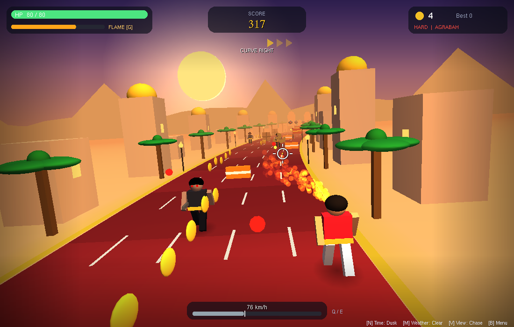
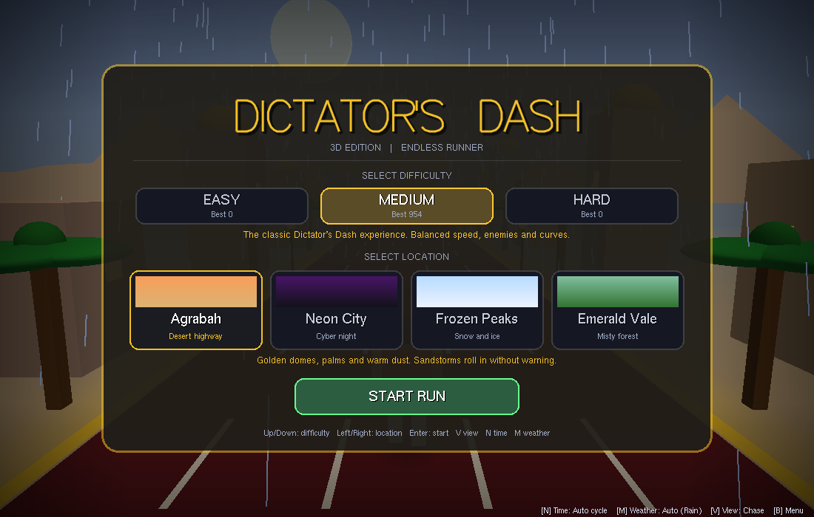
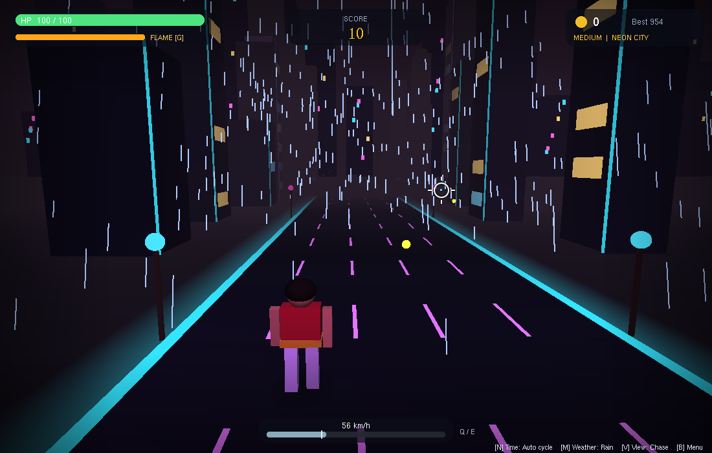
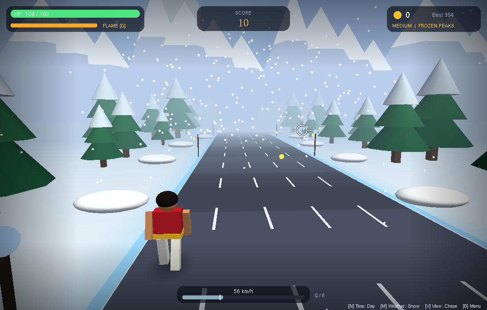
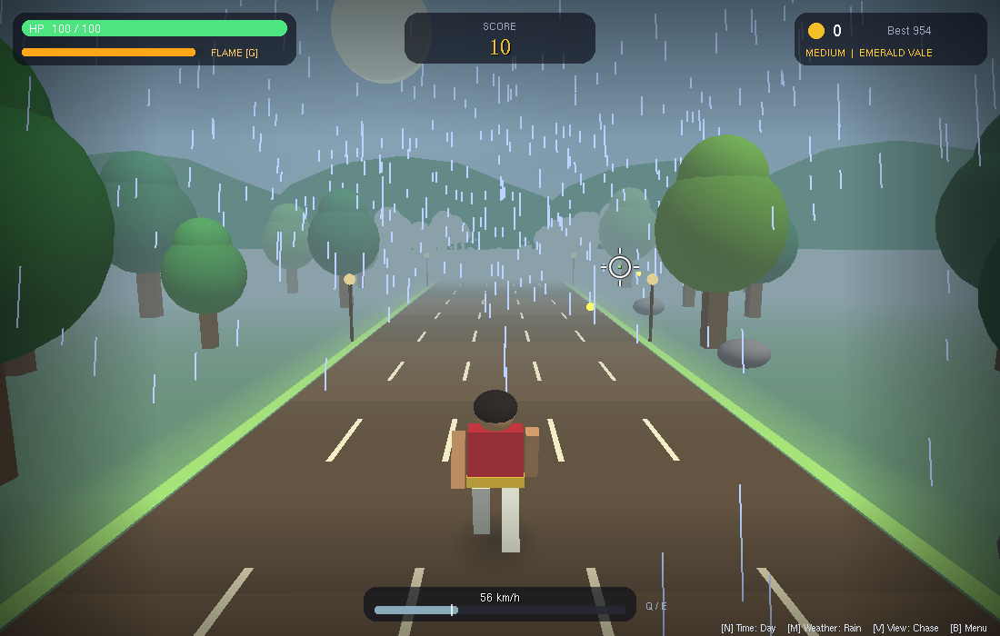
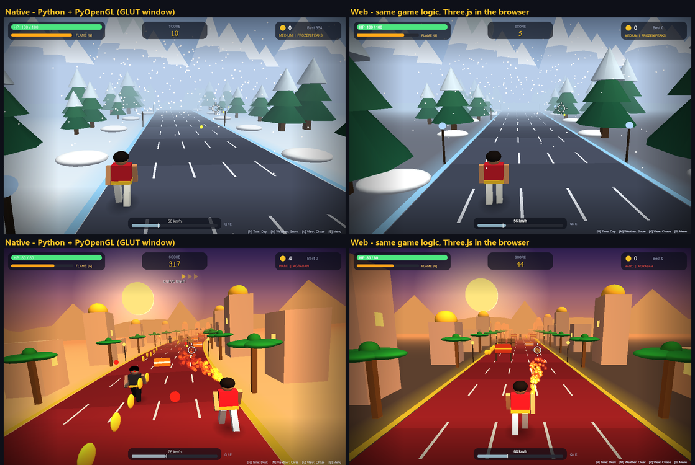
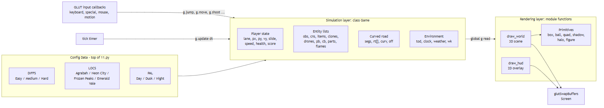

# Dictator's Dash 3D

An endless 3D lane-runner built with **Python + PyOpenGL (GLUT)** for the CSE423 Computer Graphics course. It also has a **web port** with identical game logic that runs in the browser.

Aladdin sprints down a bending royal road: jump barriers, slide under beams, shoot crates, clone guards and drones, burn them with a flamethrower, and grab coins and power-ups. Pick from three difficulties and four themed worlds, each with its own scenery, lighting, fog and weather.



**▶ Play in the browser (web version):** https://sm-mohibul-abrar.github.io/DictatorDash3D/

**⬇ itch.io (play online or download the Windows `.exe`):** https://mohib-abrar.itch.io/dictatordash3d

| Start menu | Neon City |
|---|---|
|  |  |
| **Frozen Peaks** | **Emerald Vale** |
|  |  |

## Features

- **Bending road**: random curvature segments are integrated into a lateral-offset table every frame. Game logic stays in straight lanes, and only rendering (and aiming) bends the world, so collisions stay simple. The camera banks into the turns.
- **4 worlds**: Agrabah (desert), Neon City (cyber night), Frozen Peaks (snow) and Emerald Vale (forest). Each has its own palette, fog distance, curve strength and weather odds.
- **3 difficulties**, each a data-driven table of about 20 tuned parameters.
- **Dynamic atmosphere**: day → dusk → night cycle with smoothstep blending, plus rain, snow and sandstorm weather that cross-fade, and lightning.
- **Combat**:
  - Pistol aimed with the mouse, using ray unprojection plus aim assist.
  - Hold-to-fire flamethrower with fuel and overheat, using a cone hit test.
  - Clone guards that chase your lane and shoot.
  - Drones that hover, fire aimed 3-D shots, then dive at you.
- **Presentation**:
  - Gradient sky, sun halo and far backdrop silhouettes.
  - Neon road edges, soft contact shadows and particles.
  - Rounded HUD panels, vignette, speed lines, a custom reticle and stroke-font titles.
- **Three camera views**: chase, first-person and overhead. The field of view widens with speed.

## Run the OpenGL version

```bash
cd native
python 11.py            # add --msaa for multisample anti-aliasing (GPU permitting)
```

- **Windows:** needs only Python 3. PyOpenGL and the freeglut DLLs are vendored in `native/OpenGL/`, so there is nothing to install.
- **Linux:** install system GLUT first (`sudo apt install freeglut3-dev`), then run `python3 11.py`.
- A harmless `numpy` warning may be printed. Sound effects are Windows-only.

## One game, two renderers



The web build is a line-by-line port of `native/11.py`, not a re-imagining.

| Layer | Native (`native/11.py`) | Web (`web/js/`) |
|---|---|---|
| Game rules: physics, spawning, AI, damage, scoring | `class Game` | `class Game`, with the same method names, numbers and order of operations |
| 3D drawing | Legacy OpenGL calls (`glPushMatrix`, `glutSolidCube`, `glBegin`…) | The same calls, implemented on Three.js by a ~280-line shim (`glshim.js`) |
| HUD and menus | `gluOrtho2D` + GLUT fonts | The same functions and coordinates on a Canvas 2D layer |
| Input | GLUT callbacks | The same callbacks, fed by browser events; phones also get touch buttons and a portrait camera fit |
| Sound | `winsound.Beep` | Web Audio sine beeps with the same frequencies and durations |
| High score | `highscore.json` | `localStorage`, in the same JSON format |

The shim works like this:
- Every OpenGL-style call reuses a pooled Three.js object and copies the current matrix, colour and state into it.
- `renderOrder` follows the call order, so blending happens in the same order as in OpenGL.
- The web build runs at 60 FPS on integrated graphics (Intel Iris Xe).

Known differences:
- `Esc` cannot close a browser tab, so it does nothing on the web.
- Three.js has no `1/(1+kd)` light falloff, so the torch light's attenuation is approximated.
- Random numbers come from each language's own generator, so two runs are never identical (true within each version as well).

## Run the web version

Open `index.html` in a browser. Three.js loads from a CDN, so you need an internet connection. Add `?msaa` to the URL for anti-aliasing (the same as `--msaa` in the native build). Phones work in portrait and landscape (in portrait the camera widens so all five lanes stay visible). The touch controls are: swipe to move, jump or slide; tap to shoot; and icon buttons for flame, speed, view, time, weather and pause.

## Controls

| Action | Keys |
|---|---|
| Change lane | `A` / `D` or `←` / `→` |
| Jump | `Space`, `W` or `↑` |
| Slide (fast-fall in the air) | `S` or `↓` |
| Aimed shot / straight shot | Left-click / `F` |
| Flamethrower (hold) | `G` or right mouse button |
| Slower / faster | `Q` / `E` |
| Camera view / time of day / weather | `V` / `N` / `M` |
| Pause / restart / menu / quit | `P` / `R` / `B` / `Esc` |
| Menu: difficulty / location / start | `↑↓` or `1`–`3` / `←→` / `Enter` |

## Project structure

```text
├── index.html              Web version entry (served by GitHub Pages)
├── web/
│   ├── js/game.js          Line-by-line port of 11.py (same Game class, draw code and HUD)
│   ├── js/glshim.js        Legacy OpenGL/GLUT calls implemented on Three.js
│   └── css/style.css       Canvas layout + touch buttons
├── native/
│   ├── 11.py               The OpenGL game (single file, ~1,650 lines)
│   ├── OpenGL/             Vendored PyOpenGL 3.1.7 + Windows freeglut DLLs
│   ├── Dockerfile          Browser streaming image (Xvfb + x11vnc + noVNC)
│   └── start.sh            Container entrypoint
└── assets/                 Screenshots and the architecture diagram used in this README
```

## Graphics techniques used

- **Projection and camera:** perspective and orthographic projection, `gluLookAt` with a banked up-vector.
- **Modelling:** hierarchical models built with the matrix stack (animated limbs that pivot at the joints).
- **Lighting:** fixed-function lighting with a directional sun and a point-light torch, colour material, Gouraud shading.
- **Atmosphere and blending:** linear fog, alpha blending, and additive blending for glow and fire.
- **Effects:** fake soft shadows, particle systems, and deterministic hash-based procedural scenery.
- **Rendering setup:** double buffering, depth testing, bitmap and stroke text.
- **Core loop:** delta-time animation.

## Architecture



## Builds

- **Web:** served from this repository by GitHub Pages (link at the top).
- **itch.io:** https://mohib-abrar.itch.io/dictatordash3d, with the browser build and the Windows download on one page.
- **Windows:** a standalone `.exe` that runs without Python, built from `native/11.py` with PyInstaller. Download it from itch.io or from this repository's Releases.

## Course

CSE423: Computer Graphics.
